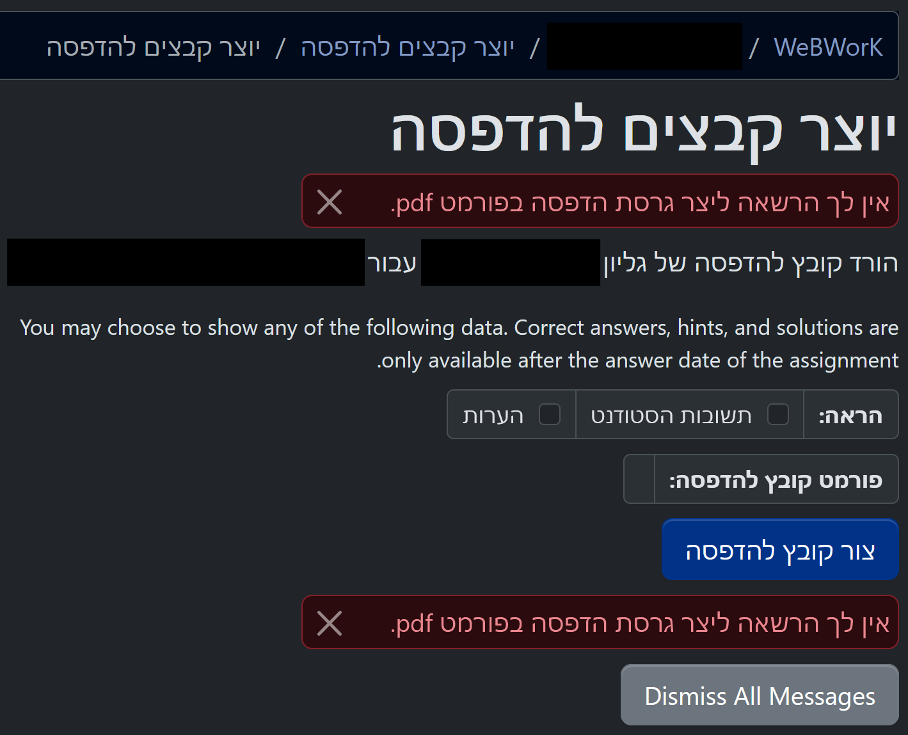
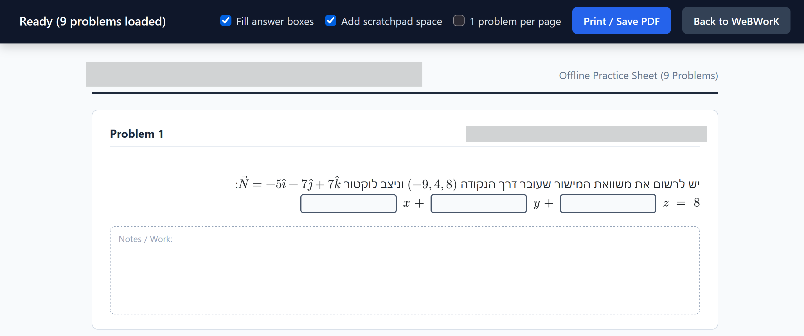

# Technion WeBWorK to PDF Bookmarklet

A client-side bookmarklet that compiles an entire Technion WeBWorK homework set into a single, formatted, printable practice worksheet (PDF). 

Supports bilingual (Hebrew/English) courses, dynamic MathJax rendering, and multi-page print layouts across Chrome, Firefox, and Safari on PC and tablets.

| Before | After |
| :---: | :---: |
|  |  |

---

## Features

- **Full Set Compilation**: Automatically fetches and merges all problems from the active homework set in parallel while reusing your existing Moodle LTI / WeBWorK session.
- **Run from Anywhere**: Launch the bookmarklet from either the **Homework Set Overview** page or any **individual Problem** page.
- **Interactive-to-Paper Conversion**: Replaces text inputs, dropdown menus, and radio/checkbox inputs with clean write-in answer boxes and printable ballot symbols (`☐`).
- **Pre-Print Controls**:
  - **Blank answer boxes**: Hides previously saved answers for a clean practice sheet.
  - **Add scratchpad space**: Appends a dedicated lined/dashed work area below each problem.
  - **1 problem per page**: Expands each problem and its scratchpad to fill a full A4 page (`break-after: page`).
- **Bilingual & MathJax Support**: Preserves right-to-left (RTL) Hebrew text alongside left-to-right (LTR) LaTeX equations, supporting both MathJax v2 and v3.

---

## Installation & Usage

### 1. Desktop (Windows, macOS, Linux — Chrome, Firefox, Safari, Edge)

1. Open [`snippet.txt`](./snippet.txt) and copy the single-line `javascript:(()=>{...` code.
2. Right-click your browser's **Bookmarks Bar** and select **Add Page...** or **Add Bookmark...**.
3. Set the **Name** to `WeBWorK to PDF`.
4. Paste the copied code into the **URL / Address** field and save.
5. **To use**: Open your homework set on `webwork.technion.ac.il`, click **WeBWorK to PDF** on your Bookmarks Bar, adjust your layout options, and click **Print / Save PDF**.

---

### 2. Tablets (iPad & Samsung Galaxy Tab)

> **Browser Compatibility Note**: Use **Chrome** or **Safari** on iPad, or **Chrome** on Android tablets. *Firefox on iPadOS is not supported because Mozilla disables bookmarklet execution on iOS/iPadOS.*

#### Option A: Chrome on iPad or Samsung Tab
1. Open [`snippet.txt`](./snippet.txt) on your tablet and tap the **Copy raw file** button.
2. In Chrome, bookmark any webpage, tap **Edit**, and set the **Name** to `WeBWorK to PDF`.
3. Clear the **URL** field, paste the copied code, and **verify that `javascript:` is still at the very beginning of the URL** (Android keyboards/Chrome sometimes strip the `javascript:` prefix on paste—if missing, type `javascript:` at the start).
4. Open your WeBWorK homework set on `webwork.technion.ac.il`.
5. **To launch**:
   - **iPad + Chrome**: Open **Bookmarks** (or type `WeBWorK to PDF` in the Address Bar) and tap the bookmark.
   - **Samsung Tab + Chrome**: Tap the **Address Bar**, type `WeBWorK to PDF`, and tap the matching suggestion with the **Star icon** (do not press Enter/Search on the keyboard).
6. Tap **Print / Save PDF** to save as PDF or share directly into **GoodNotes**, **Notability**, or **Samsung Notes**.

#### Option B: Safari on iPad
1. Enable Safari's Favorites Bar (**Settings → Safari → Show Favorites Bar**).
2. Open [`snippet.txt`](./snippet.txt) and tap the **Copy raw file** button.
3. In Safari, add a bookmark for any webpage into your **Favorites**, then open the **Bookmarks sidebar → Edit**, select that bookmark, rename it to `WeBWorK to PDF`, replace its URL with the copied code, and tap **Done**.
4. **To launch**: Open your WeBWorK homework set and tap **WeBWorK to PDF** directly on your **Favorites Bar** (or inside the Bookmarks menu). *Do not launch via the Safari Address Bar, as Safari blocks scripts triggered from the search field.*

---

## Repository Structure

| File | Description |
| :--- | :--- |
| **`snippet.txt`** | Self-contained, minified single-line `javascript:` URI ready to paste directly into a browser bookmark. |
| **`technion_webwork_pdf_bookmarklet.js`** | Full readable and commented source code for reference and customization. |

---

## How It Works

1. **Link Discovery**: Scans the page for URLs matching the current course and homework set path (`/webwork2/<course>/<set>/<problem>`), ignoring 6-digit Technion course numbers in breadcrumb navigation. If triggered inside a Moodle LTI `<iframe>` wrapper, it automatically navigates to the direct WeBWorK frame first.
2. **Parallel Fetching**: Requests all problem pages concurrently via `fetch(..., { credentials: 'include' })` and parses them with `DOMParser`.
3. **DOM Cleaning**: Extracts `.problem-content` / `#problem_body`, strips navigation and submission buttons, resolves relative image URLs, and normalizes `<script type="math/tex">` nodes.
4. **MathJax Typesetting**: Invokes the page's local MathJax engine (or injects the course's MathJax config) to render all equations before printing.

---

## Customization

1. Modify the readable source code in [`technion_webwork_pdf_bookmarklet.js`](./technion_webwork_pdf_bookmarklet.js).
2. Because `webwork.technion.ac.il` enforces a strict Content Security Policy (`script-src 'self'`), the bookmarklet in `snippet.txt` must remain self-contained rather than loading external scripts.
3. When minifying back into a single-line `javascript:` URI for `snippet.txt`, avoid `#`, `%`, and `\` characters (use `rgb(...)` colors, `[id="..."]`, and `String.fromCharCode(...)`) to ensure cross-browser compatibility.
